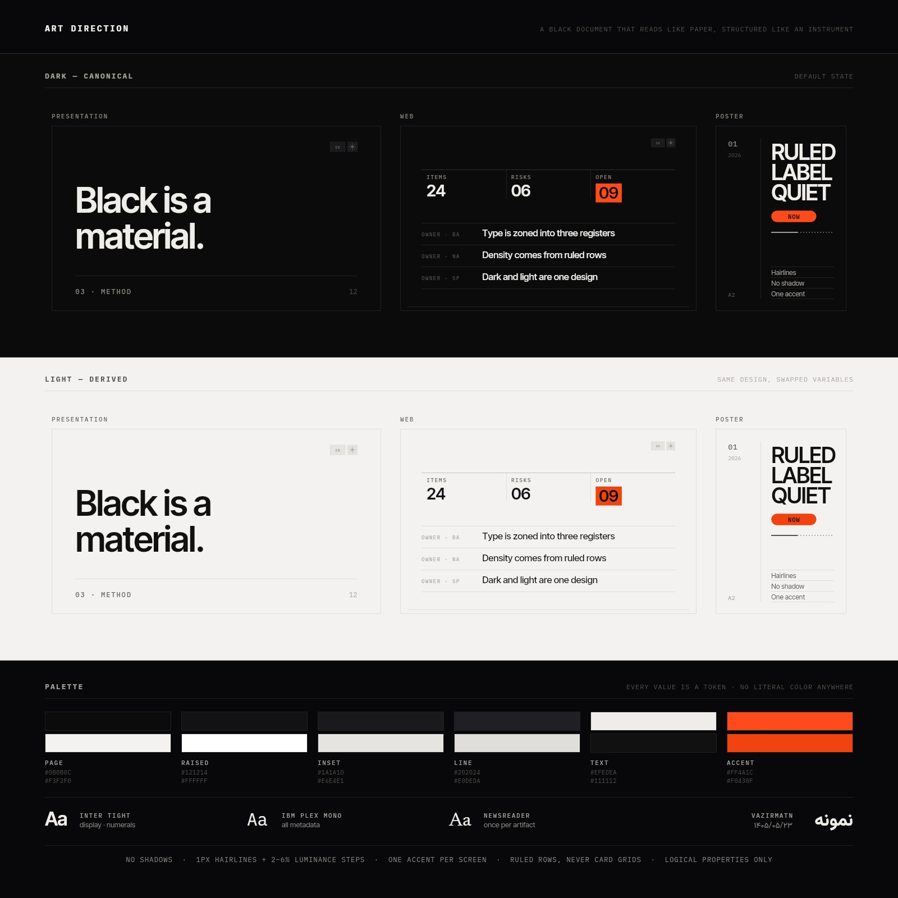

# Art Direction

**A black document that reads like paper and is structured like an instrument.**

A single-file art direction spec, written to be handed to an AI. Point Claude, ChatGPT, Cursor or v0 at [`art-direction.md`](art-direction.md) and ask for a website, a deck, a poster or a report — the output comes back on-system, in four states, without further instruction.



---

## What it is

Most "design systems" handed to an AI are a palette and a font list. The model then invents everything that actually determines how the result feels: shadow depth, radius scale, how often to use the accent, what to do when the language flips.

This file removes those decisions. It is written as a specification with pass/fail criteria, not as inspiration.

The direction in one paragraph:

> Black is a material with layers, never a backdrop. Depth is 1px hairlines and 2–6% luminance steps — no shadows anywhere. One hot orange-red accent, spent at most once per screen, only as solid fill carrying black text or as a thin structural mark meaning "act here". Three type registers: tight grotesque for display and numerals, uppercase tracked monospace for all metadata, one serif appearing exactly once. Density comes from ruled rows with a label gutter, never from card grids. Dark is the canonical theme; light is the same design with swapped variables. English is the primary language; Persian — not Arabic — is the second, and every artifact ships both, with a language toggle and a theme toggle always present. All CSS logical properties, no physical directions.

---

## How to use it

**Whole file.** Paste `art-direction.md` into the context and describe the artifact. This is the intended path — the file's §0 tells the model to declare its medium and base size first, and to self-audit against §12 afterward.

```
[contents of art-direction.md]

Build a landing page for a developer tools company. Three sections.
```

**Compressed.** When the context is tight, §0 contains a one-paragraph preamble that carries most of the identity. Quality drops, but the result is still recognisably on-system.

**As a project file.** Drop it in a repo as `CLAUDE.md`, `.cursorrules`, or an agent skill and it applies to everything built there.

**Reviewing existing work.** §12 is a checklist an AI can run against code it did not write. Several lines are literal grep tests.

---

## Contents

| § | | |
|---|---|---|
| 0 | How to use this file | Instructions for humans and for AI; the compressed preamble |
| 1 | The invariants | Ten rules that hold in every medium, size, theme and script |
| 2 | The concept | The one-sentence thesis |
| 3 | Color system | Dark and light tokens; the four places the accent is permitted and the many where it is not |
| 4 | Typography | Four faces; ten registers defined as multipliers of a per-medium base |
| 5 | Language & theme | English/Persian and dark/light; Persian-specific typesetting; bidi; **the topbar component** |
| 6 | Layout & grid | The label rail, measure, the 4px spacing scale, two breakpoints |
| 7 | Surface, depth & imagery | No shadows; the four radii; why cards are rationed |
| 8 | Data expression | A fixed vocabulary — level meters, dot bars, dotted tracks, timelines |
| 9 | Motion | What is permitted, and why horizontal slide-ins are banned outright |
| 10 | Medium translations | Web, presentations, posters/print, and **mobile & touch** |
| 11 | What would break this | Eleven named failure modes |
| 12 | Acceptance checklist | Run in all four states; report PASS/FAIL |

---

## Two things worth reading even if you never use the rest

**§5.2 — Persian, specifically, not Arabic.** Persian and Arabic share a script family and nothing else that matters. This section lists what every AI gets wrong: Arabic-Indic digits (`٠١٢`) instead of Persian (`۰۱۲`), Arabic `ك`/`ي` instead of `ک`/`ی`, missing ZWNJ half-spaces, Arabic-first fonts. Most are greppable, so they appear in §12 as zero-hit tests.

**§4 — registers, not sizes.** Type is specified as ten named registers with multipliers against a base you set per medium. The same scale produces a 15px web document, a 24px slide and an A1 poster without a second table.

---

## The four states

Every artifact exists in a 2×2 and all four are first-class:

|  | Dark | Light |
|---|---|---|
| **English** | default on first load | |
| **Persian** | | |

A language toggle and a theme toggle are non-negotiable furniture in every medium. §5.5 specifies the topbar component that carries them, down to the CSS.

---

## Provenance

Distilled from a working art direction, then generalised across media. The topbar in §5.5 is the real component from [learn-roadmap.netlify.app](https://learn-roadmap.netlify.app/), transcribed rather than redesigned.

The specimen image above is generated from the spec's own tokens — see [`tools/specimen.js`](tools/specimen.js).

## License

MIT — see [LICENSE](LICENSE). Use it, fork it, change the accent to green. Attribution appreciated but the license is what governs.
